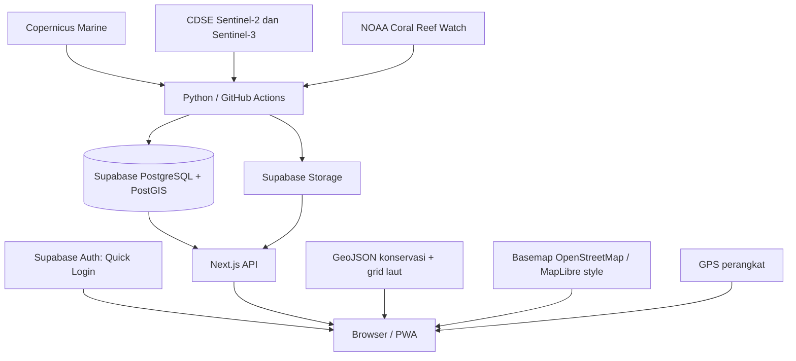

# Nakhoda

**Peta kondisi perairan untuk nelayan, ruang pemantauan ekosistem untuk pemerintah.**

Nakhoda adalah aplikasi web progresif (PWA) berbahasa Indonesia untuk hackathon yang berfokus pada nelayan tradisional dan keberlanjutan pesisir. Pilot saat ini mencakup **Teluk Jakarta dan Kepulauan Seribu**.

Aplikasi menyatukan data suhu permukaan laut, klorofil, tekanan panas karang, citra satelit, rujukan konservasi, dan laporan lapangan dalam dua ruang kerja:

- **Nelayan:** membaca peta kondisi perairan, memeriksa zonasi, melihat posisi GPS, dan membuat laporan.
- **Pemerintah:** meninjau peta masalah, laporan dan indikasi satelit, kemudian memperbarui status, prioritas, serta catatan penanganan.

Keduanya menggunakan **Quick Login tanpa email atau kata sandi**. Data yang terlihat bergantung pada konfigurasi backend, publikasi pipeline, umur pengamatan, dan kualitas sumber.

**Aplikasi:** [nakhoda-eight.vercel.app](https://nakhoda-eight.vercel.app/)

**Repository:** [DavidLauda/Nakhoda](https://github.com/DavidLauda/Nakhoda)

**Dokumentasi diperbarui:** 16 Oktober 2026, berdasarkan implementasi repository. Deployment publik dapat berbeda sampai commit terbaru di-deploy.

> Skor lingkungan merupakan perbandingan kondisi dalam data yang tersedia. Skor bukan prediksi jumlah ikan, izin penangkapan, atau jaminan keselamatan pelayaran. Indikasi satelit memerlukan pemeriksaan lapangan sebelum disimpulkan sebagai kerusakan ekosistem.

## Daftar isi

1. [Masalah dan tujuan](#1-masalah-dan-tujuan)
2. [Fitur dan alur pengguna](#2-fitur-dan-alur-pengguna)
3. [Cakupan wilayah](#3-cakupan-wilayah)
4. [Cara membaca peta nelayan](#4-cara-membaca-peta-nelayan)
5. [Sumber data dan perhitungan](#5-sumber-data-dan-perhitungan)
6. [Arsitektur dan teknologi](#6-arsitektur-dan-teknologi)
7. [Menjalankan aplikasi lokal](#7-menjalankan-aplikasi-lokal)
8. [Environment variables](#8-environment-variables)
9. [Quick Login dan hak akses](#9-quick-login-dan-hak-akses)
10. [Menjalankan pipeline satelit](#10-menjalankan-pipeline-satelit)
11. [Membaca hasil pipeline](#11-membaca-hasil-pipeline)
12. [Deploy ke Vercel](#12-deploy-ke-vercel)
13. [PWA dan pengujian di HP](#13-pwa-dan-pengujian-di-hp)
14. [Struktur repository dan data](#14-struktur-repository-dan-data)
15. [Pengujian dan pemeliharaan](#15-pengujian-dan-pemeliharaan)
16. [Troubleshooting](#16-troubleshooting)
17. [Panduan demo hackathon](#17-panduan-demo-hackathon)
18. [Batasan dan pengembangan berikutnya](#18-batasan-dan-pengembangan-berikutnya)
19. [Dokumentasi pendukung](#19-dokumentasi-pendukung)

## 1. Masalah dan tujuan

Nelayan tradisional menghadapi tekanan akibat rusaknya terumbu karang dan mangrove, abrasi, sampah laut, serta perubahan kondisi perairan. Informasi laut dan batas konservasi sering tersedia pada sumber berbeda sehingga sulit digunakan bersama saat merencanakan aktivitas.

| Pengguna | Kebutuhan | Bantuan aplikasi |
| --- | --- | --- |
| Nelayan | Menentukan lokasi eksplorasi dan mengenali wilayah yang perlu dihindari atau diperiksa | Grid kondisi laut, konservasi, tanggal data, GPS |
| Pemerintah | Menentukan prioritas pemeriksaan dan tindakan | Peta masalah, bukti laporan/satelit, penilaian, riwayat perubahan |

Pilot mengutamakan keterlacakan sumber, waktu, kualitas, dan keterbatasan hasil. Belum ada klaim peningkatan tangkapan atau pemulihan ekosistem yang tervalidasi melalui studi dampak.

## 2. Fitur dan alur pengguna

### 2.1 Nelayan

1. Pilih **Masuk sebagai Nelayan**.
2. Buka **Peta perairan** dan pilih kotak untuk membaca skor, suhu, klorofil, waktu, dan sumber.
3. Tekan **Tampilkan lokasi saya** bila membutuhkan GPS. Browser meminta izin pada langkah ini.
4. Periksa posisi, jarak/arah ke sel pilihan, dan peringatan zona bila tersedia. Jarak/arah bukan rute pelayaran.
5. Gunakan **Buat laporan** untuk masalah pesisir: kategori, lokasi, waktu, deskripsi, foto atau alasan laporan tanpa foto sesuai formulir.
6. Pantau laporan sendiri melalui **Laporanku**.
7. Gunakan **Akun & keluar** untuk berpindah ruang kerja atau memasang PWA.

Kategori laporan: karang rusak, mangrove rusak, abrasi pantai, sampah laut, pencemaran air, dan lainnya. Kategori adalah pernyataan pelapor yang masih perlu ditinjau.

GPS pada peta diproses di browser dan tidak dikirim ke server. **Hentikan GPS** menghapus posisi dari tampilan; pemantauan juga berhenti ketika halaman dilepas. Modul perjalanan lama mempunyai mekanisme penyimpanan tersendiri dan tidak termasuk pernyataan privasi GPS peta ini.

### 2.2 Pemerintah

1. Pilih **Masuk sebagai Pemerintah**.
2. Buka **Peta masalah**, gunakan filter jenis/status, dan pilih sel untuk melihat bukti.
3. Buka **Laporan masuk** untuk laporan lapangan dan indikasi satelit.
4. Pada detail laporan, periksa deskripsi, foto, konteks satelit, dan riwayat pemeriksaan.
5. Pada **indikasi satelit**, bandingkan citra sebelum/sesudah/selisih, luas perubahan, tanggal, awan, serta keterbatasan analisis.
6. Isi **Penilaian indikasi** langsung pada halaman tersebut.
7. Periksa **Kesehatan data** untuk membedakan waktu pemeriksaan sumber dari waktu pengamatan yang layak.

| Isian penilaian | Fungsi |
| --- | --- |
| Update status | Tahap penanganan |
| Prioritas | Rutin, Tinjau prioritas, Tinjau segera |
| Catatan untuk nelayan | Informasi yang dapat dibaca pada detail observasi/laporan terkait |
| Catatan internal | Informasi bagi pengguna berhak meninjau |
| Alasan perubahan | Penjelasan yang masuk riwayat perubahan |

Pilihan status: **Baru, Sedang ditinjau, Siap dirujuk, Dirujuk, Diterima petugas, Sedang ditangani, Selesai**, dan **Ditutup tanpa penyelesaian**. Formulir tidak mewajibkan semua status dilalui berurutan.

Alasan perubahan wajib 3–1.000 karakter; catatan untuk nelayan maksimal 2.000 karakter; catatan internal maksimal 4.000 karakter. Nomor revisi digunakan agar perubahan pengguna lain tidak tertimpa tanpa diketahui.

**Halaman tindak lanjut/kasus terpisah sudah digantikan oleh penilaian pada indikasi.** URL kasus lama diarahkan ke bukti terkait. Email sudah dihapus; memilih status “Dirujuk” tidak mengirim email otomatis.

### 2.3 Aturan peta masalah

Grid pemerintah **0,05°**, berbeda dari grid tampilan nelayan 0,01°. Sel diberi kode kolom/baris.

| Kategori | Aturan |
| --- | --- |
| Bermasalah | Laporan terverifikasi, minimal dua laporan terbuka, atau satu laporan terbuka disertai indikasi satelit |
| Perlu dicek | Satu laporan terbuka atau indikasi satelit saja |
| Tidak ditandai | Belum memenuhi aturan; bukan bukti bebas masalah |

Indikasi NOAA memakai kode alert maksimum tujuh hari ≥ 2. Indikasi optik memerlukan piksel kandidat dan pemeriksaan awan. Keyakinan laporan memakai tiga unsur: foto, laporan lain pada sel sama, dan indikasi satelit. Label tersebut adalah bantuan peninjauan, bukan probabilitas ilmiah.

## 3. Cakupan wilayah

Konfigurasi utama: `pipeline/config/pilot.json`.

| Parameter | Nilai |
| --- | --- |
| Koordinat | WGS84; bounding box `[barat, selatan, timur, utara]` |
| Bounding box | `[106.35, -6.20, 107.10, -5.35]` |
| Wilayah | Teluk Jakarta dan Kepulauan Seribu |
| Grid tampilan nelayan | 0,01°, sekitar 1,1 km |
| Grid Marine standar / peta masalah | 0,05°, sekitar 5,5 km |
| Studi Sentinel-2 | 10 kotak kecil, bukan seluruh bounding box |

Kotak studi: Pari, Pramuka, Payung, Tidung Kecil, Tidung Besar, Karang Beras, Rambut, serta `tn_inti_a`, `tn_inti_b`, dan `tn_inti_c` di zona inti taman nasional. Kotak-kotak ini belum memiliki mask habitat terumbu terverifikasi.

Ukuran grid, resolusi sumber, dan wilayah studi berbeda. Memperluas wilayah memerlukan pembaruan mask laut, grid konservasi, batas API, dan anggaran data; mengganti judul wilayah saja tidak memperluas dukungan.

## 4. Cara membaca peta nelayan

### 4.1 Legenda

| Warna | Label | Makna |
| --- | --- | --- |
| Hijau tua | Skor Tinggi | Skor ≥ 60 |
| Hijau muda | Skor Sedang | Skor < 60 yang masih layak ditampilkan |
| Kuning | Periksa dulu | Menyentuh Pemanfaatan/Pemanfaatan Terbatas; periksa aturan kegiatan |
| Merah | Hindari memancing | Menyentuh Inti/Perlindungan Bahari |
| Abu-abu | Belum ada data | Tidak ada pengukuran detail atau cadangan layak untuk skor |

Warna transparan membantu peta dasar tetap terlihat. GPS merupakan penanda terpisah.

### 4.2 Prioritas satu grid

```text
Konservasi → data detail terukur → perkiraan data kasar → belum ada data
```

- Konservasi mengalahkan skor meskipun skor tinggi.
- Prioritas geometri ketika zona bertumpuk: Inti, Perlindungan Bahari, lalu Pemanfaatan/Pemanfaatan Terbatas.
- Bagian daratan dipotong menggunakan grid laut turunan GSHHG; ketelitian garis pantai mengikuti dataset.
- Kotak yang menyentuh poligon konservasi dapat lebih luas dari poligon asli. Ini penyederhanaan tampilan; **batas hukum tidak berubah menjadi kotak**.

### 4.3 Terukur dan perkiraan

| Jenis | Asal | Perilaku |
| --- | --- | --- |
| Detail terukur | Pasangan SST Sentinel-3 dan klorofil OLCI lolos kualitas, diagregasi ke 0,01° | Bisa masuk peringkat/Top 3 bila di luar konservasi dan pada bagian laut layak |
| Perkiraan | Nilai Marine 0,05° yang meliputi kotak | Beberapa kotak memakai nilai sumber sama; detail menyebut perkiraan; tidak masuk Top 3 |
| Belum ada data | Kedua sumber tidak tersedia/layak | Abu-abu tanpa skor buatan |

Kotak kecil tidak menambah resolusi pengukuran. Perkiraan tetap membawa informasi sekitar 5,5 km meskipun ditampilkan pada grid 0,01°.

Skor disembunyikan jika interval pengamatan melewati tujuh hari, waktu tidak valid, ada pengecualian, atau nilai suhu/klorofil/skor tidak layak. Detail dipilih dari publikasi yang tercatat selesai; data kasar terbaru mengisi bagian yang belum memiliki detail. Peta meminta pembaruan setiap lima menit.

### 4.4 Konservasi

- `public/conservation-north-big.geojson`: zonasi Taman Nasional Kepulauan Seribu dari layer publik BIG.
- `public/conservation-south-kkp-2026.geojson`: turunan tabel koordinat Lampiran I Keputusan KKP 28/2026.
- `public/conservation-grid.json`: persilangan poligon dengan grid tampilan.

Geometri selatan direkonstruksi script proyek. Script mencatat ketidaksesuaian bentuk Area III terhadap gambar lampiran dan tidak memasukkan tabel “Zona Lain” dengan penomoran ambigu. Kelengkapan dan aturan aktivitas perlu divalidasi dengan sumber berwenang sebelum penggunaan operasional.

## 5. Sumber data dan perhitungan

### 5.1 Peran sumber

| Sumber / mode | Informasi | Penggunaan |
| --- | --- | --- |
| Copernicus Marine / `marine` | SST OSTIA, klorofil L4 | Skor standar dan cadangan |
| Marine + CDSE Sentinel-3 / `marine-highres` | Klorofil OLCI L3, SST SLSTR L2P | Skor detail eksperimental |
| CDSE Sentinel-2 / `sentinel` | Perbandingan citra L2A | Indikasi perubahan optik |
| NOAA Coral Reef Watch / `noaa` | SST, HotSpot, DHW, alert tujuh hari | Konteks panas karang |
| BIG dan KKP | Zonasi | Pemeriksaan konservasi |
| Laporan pengguna | Foto, lokasi, waktu, deskripsi | Bukti lapangan |

Nelayan terutama memakai Marine; pemerintah memakai Sentinel-2, NOAA, dan laporan. Sumber saling melengkapi, bukan terbatas secara eksklusif pada satu portal.

### 5.2 Skor lingkungan

Implementasi: `pipeline/analysis/environment.py`, algoritme standar `environment-index-v0.4`.

1. Pasangkan suhu/klorofil pada grid sama.
2. Pilih sel laut dengan suhu valid dan klorofil positif.
3. Hitung gradien suhu memakai jarak geografis dalam meter dan tetangga langsung valid.
4. Hitung peringkat persentil gradien `F` serta log-klorofil `p`.
5. Gabungkan komponen:

```text
C = max(0, 1 - abs(p - 0.60) / 0.40)
Skor = round(100 × (0.60 × F + 0.40 × C))
```

Minimal 20 sel layak dan variasi spasial cukup diperlukan. Bobot/komponen adalah hipotesis pilot, belum dikalibrasi terhadap tangkapan atau spesies. Skor relatif terhadap pasangan data; skor 80 bukan peluang mendapat ikan 80%.

### 5.3 Marine standar

| Variabel | Dataset ID dalam konfigurasi |
| --- | --- |
| SST | `METOFFICE-GLO-SST-L4-NRT-OBS-SST-V2` |
| Klorofil | `cmems_obs-oc_glo_bgc-plankton_nrt_l4-gapfree-multi-4km_P1D` |

Selisih waktu pasangan maksimal 72 jam. Grid bersama 0,05° mengikuti SST; klorofil diagregasi. Mask analisis Natural Earth menyaring sel yang bertumpang tindih daratan. Batas publikasi 300 sel; melebihi batas menghasilkan error, bukan pemotongan diam-diam.

### 5.4 Marine detail

Implementasi: `pipeline/highres_run.py`, `pipeline/providers/highres.py`, `pipeline/analysis/highres.py`; algoritme `environment-index-highres-v0.2`.

- Klorofil: `cmems_obs-oc_glo_bgc-plankton_nrt_l3-olci-300m_P1D`.
- SST: Sentinel-3 SLSTR `SL_2_WST___` melalui OData CDSE.
- Grid hasil 0,01°, sekitar 1,1 km.
- Klorofil positif, ketidakpastian ≤ 60%, minimal dua piksel valid per sel, proporsi air menurut OLCI ≥ 80%.
- SST memiliki `quality_level ≥ 4`, suhu/ketidakpastian valid, bebas flag darat/es/danau/sungai/awan yang ditolak.
- Gradien satu sisi diperbolehkan jika tetangga langsung tersedia pada kedua sumbu; flag `sst_gradient_one_sided` dicatat.
- Publikasi minimal 100, maksimal 5.000 sel.
- Discovery dibatasi maksimal empat tanggal kandidat dan delapan unduhan SST dari sampel terkini.

Sel gagal akibat awan, kualitas, ketidakpastian, pasangan kosong, atau tetangga gradien tidak cukup. Pipeline detail tidak mengisi lubang melalui interpolasi buatan. Perkiraan kasar dilakukan terpisah pada tampilan.

### 5.5 Sentinel-2

Implementasi: `pipeline/analysis/optical.py`, `optical-change-v0.2`.

| Pemeriksaan | Konfigurasi |
| --- | --- |
| Citra terkini | Jendela 30 hari |
| Pembanding | Tile sama, 30–120 hari lebih awal |
| Input | B02/B03/B04/B08, SCL, dataMask |
| Grid proses | EPSG:32748, sekitar 10 m |
| Buffer awan/bayangan | 5 piksel, sekitar 50 m |
| Awan dalam kotak | Maksimum 5% masing-masing citra |
| Overlap valid | Minimum 70% setelah masking |
| Pergeseran kecerahan luas | Ambang 0,08 |
| Kandidat | Sinyal terstandardisasi > 3, komponen minimal 9 piksel |

Awan kotak berbeda dari awan seluruh scene. Data lama tanpa metrik awan kotak memakai aturan cadangan awan scene pada tampilan. Perubahan bisa berasal dari pasang, kekeruhan, pantulan matahari, buih, kapal, atau sisa awan. Belum ada koreksi kedalaman/kolom air dan mask habitat terumbu terverifikasi.

### 5.6 NOAA

`crw-heat-v0.1` mengambil sel asli NOAA CRW v3.1 0,05° terdekat dari pusat studi. SST/HotSpot memakai °C; Degree Heating Weeks (DHW) memakai °C-weeks. Alert tujuh hari mempunyai interval tersendiri. Kotak berdekatan dapat memakai sel NOAA sama; hasil merupakan konteks regional.

## 6. Arsitektur dan teknologi



| Lapisan | Teknologi |
| --- | --- |
| Web | Next.js 15, React 19, TypeScript |
| Peta | MapLibre GL; raster OSM bawaan atau style opsional |
| API | Next.js Route Handler, `lib/api.ts` |
| Backend | Supabase Auth, PostgreSQL/PostGIS, Storage |
| Validasi | Zod |
| Data lokal | Dexie / IndexedDB |
| Gambar | Sharp, Pillow |
| Analisis | Python, NumPy, xarray, NetCDF4, SciPy, rasterio, Copernicus Marine Toolbox |
| Hosting | Vercel web/API; Actions pipeline |
| Pemeriksaan | TypeScript, ESLint, Node test runner, pytest |

Nama internal `pesisir` masih dipakai pada package/komponen/database lokal untuk kompatibilitas. Produk yang ditampilkan adalah Nakhoda.

## 7. Menjalankan aplikasi lokal

### 7.1 Prasyarat

- Git dan Node.js **22.x** beserta npm, sesuai CI.
- Supabase dengan izin migrasi dan konfigurasi Auth.
- Python **3.12** hanya untuk pipeline/test Python.
- Internet untuk Supabase, basemap, dan provider.

### 7.2 Clone

```powershell
git clone https://github.com/DavidLauda/Nakhoda.git
cd Nakhoda
npm ci
Copy-Item .env.example .env.local
```

Salin template hanya bila `.env.local` belum ada. Setiap anggota tim mengisi file lokal sendiri; file tidak ikut Git.

### 7.3 Supabase

1. Buat/pilih proyek tujuan.
2. Pada database baru untuk aplikasi, jalankan seluruh `supabase/migrations/202610140001_initial.sql` melalui SQL Editor.
3. Migrasi membuat extension, tipe, tabel, indeks, trigger profil, area pilot, RLS, dan bucket Storage.
4. Aktifkan **Allow anonymous sign-ins** pada Auth.
5. Ambil Project URL, publishable/anon key, dan kunci server.

Migrasi awal bukan reset dan tidak dirancang diulang pada skema lengkap. Periksa objek yang sudah diterapkan bila proyek memiliki data; jangan menghapus tabel untuk menyelesaikan error objek sudah ada.

Pemeriksaan keberadaan:

```sql
select to_regclass('public.profiles') as profiles,
       to_regclass('public.study_areas') as study_areas,
       to_regclass('public.analysis_runs') as analysis_runs,
       to_regclass('public.environment_cells') as environment_cells;

select code, name from public.study_areas where code = 'pilot';
```

`NULL` berarti tabel belum ditemukan. Query tidak membuat tabel atau memvalidasi seluruh trigger/kebijakan.

### 7.4 Konfigurasi dan jalankan

Isi `.env.local` untuk demo dua portal dengan peninjauan:

```dotenv
NEXT_PUBLIC_SUPABASE_URL=https://<project-ref>.supabase.co
NEXT_PUBLIC_SUPABASE_ANON_KEY=<publishable-key>
SUPABASE_SERVICE_ROLE_KEY=<server-only-key>
QUICK_LOGIN_FULL_ACCESS=true
```

Flag `QUICK_LOGIN_FULL_ACCESS` dibaca server tetapi belum tercantum di `.env.example` saat penulisan; tambahkan untuk demo peninjauan. Lihat bagian 9.

```powershell
npm run dev
```

Buka [localhost:3000](http://localhost:3000/). Jika port dipakai, ikuti terminal. Mulai ulang Next.js setelah mengubah environment.

Backend baru belum otomatis berisi data satelit. Jalankan pipeline atau gunakan proyek tim yang telah diisi. `/source-probe` menampilkan snapshot NOAA lokal terpisah dari data live.

## 8. Environment variables

| Tempat | Fungsi |
| --- | --- |
| `.env.local` | Web lokal; dibaca eksplisit runner highres |
| Vercel Environment Variables | Web/API deployment |
| GitHub Actions Secrets | Pipeline Python |

Mengisi satu tempat tidak otomatis mengisi lingkungan lain.

| Variabel | Web lokal / Vercel | Actions | Keterangan |
| --- | --- | --- | --- |
| `NEXT_PUBLIC_SUPABASE_URL` | Wajib | Publikasi | URL proyek |
| `NEXT_PUBLIC_SUPABASE_ANON_KEY` | Wajib | Tidak diperlukan | Publishable `sb_publishable_...` atau anon lama |
| `SUPABASE_SERVICE_ROLE_KEY` | Wajib API | Publikasi | Kunci server; tanpa `NEXT_PUBLIC_` |
| `QUICK_LOGIN_FULL_ACCESS` | `true` untuk peninjauan | Tidak diperlukan | Reviewer demo pilot |
| `NEXT_PUBLIC_MAP_STYLE_URL` | Opsional | Tidak diperlukan | Style MapLibre dengan izin sesuai |
| `CDSE_CLIENT_ID` | Tidak diperlukan | `sentinel` | OAuth Sentinel Hub |
| `CDSE_CLIENT_SECRET` | Tidak diperlukan | `sentinel` | Rahasia OAuth client |
| `CDSE_USERNAME` | Tidak diperlukan | `marine-highres` | Email login CDSE, bukan First/Last name |
| `CDSE_PASSWORD` | Tidak diperlukan | `marine-highres` | Password CDSE |
| `COPERNICUSMARINE_SERVICE_USERNAME` | Tidak diperlukan | `marine`, `marine-highres` | Username Marine |
| `COPERNICUSMARINE_SERVICE_PASSWORD` | Tidak diperlukan | `marine`, `marine-highres` | Password Marine |
| `APP_BASE_URL` | Ada di template; belum dibaca | Tidak diperlukan | Bukan syarat demo |

`EMAIL_SENDER` dan Gmail tidak diperlukan. `GITHUB_RUN_URL` disediakan workflow, bukan secret manual.

Publishable key memang dipakai browser. Server key dan kredensial provider tetap di server/runner. `next.config.ts` menolak secret key/JWT service-role yang salah dimasukkan ke variabel kunci publik.

## 9. Quick Login dan hak akses

Quick Login memanggil `signInAnonymously()` untuk membuat sesi Supabase tanpa email/password. Identitas tetap ada untuk kepemilikan laporan. Lihat [Supabase Anonymous Sign-Ins](https://supabase.com/docs/guides/auth/auth-anonymous).

| Pengguna / konfigurasi | Hak |
| --- | --- |
| Quick Login Nelayan | Membaca data, mengelola laporan sendiri |
| Pemerintah + `QUICK_LOGIN_FULL_ACCESS=true` | Reviewer melalui API untuk pilot |
| Pemerintah tanpa flag | Portal bisa dipilih; endpoint peninjauan yang memerlukan reviewer menolak akses |
| Reviewer non-anonim | Role reviewer dan penugasan area |
| Admin | Hak administratif; tidak diberikan Quick Login |

Flag demo memungkinkan pengunjung pemerintah meninjau data pilot bersama. Gunakan untuk konteks hackathon yang mengizinkannya. Penggunaan institusional membutuhkan akun/penugasan petugas.

**Pindah portal:** gunakan **Pindah ke ruang kerja …** di Akun untuk mempertahankan sesi dan kepemilikan laporan.

**Keluar, menghapus data browser, atau memakai perangkat lain:** sesi anonim tidak punya email/password pemulihan. Masuk lagi dapat membuat identitas baru; laporan lama tetap di backend tetapi bukan milik sesi baru.

## 10. Menjalankan pipeline satelit

### Persiapan akun provider

- **Copernicus Marine:** siapkan akun Marine dengan username/password yang dipakai Toolbox. Masuk melalui layanan lain pada website belum tentu menyediakan pasangan kredensial yang diharapkan adapter ini.
- **Sentinel-2:** pada Sentinel Hub Dashboard CDSE, buat OAuth client untuk penggunaan server. Simpan client ID dan client secret sebagai pasangan `CDSE_CLIENT_ID`/`CDSE_CLIENT_SECRET`; jangan pilih konfigurasi SPA/frontend untuk runner server.
- **Sentinel-3:** runner OData menggunakan email login akun CDSE dan password sebagai `CDSE_USERNAME`/`CDSE_PASSWORD`. Ini berbeda dari OAuth client Sentinel Hub.
- **Supabase:** URL proyek dan server key diperlukan untuk menulis hasil ke backend yang dibaca aplikasi.

Jangan menempelkan nilai kredensial di README, screenshot, issue, atau commit. Gunakan tempat konfigurasi pada bagian 8. Nama dataset pada bagian 5 adalah konfigurasi repository; ketersediaannya pada provider harus diperiksa saat run.

### 10.1 GitHub Actions

1. Isi secrets pada **repository → Settings → Secrets and variables → Actions**.
2. Buka **Actions → Satellite pilot pipeline → Run workflow**.
3. Pilih branch terbaru dan sumber yang dibutuhkan.

| Pilihan | Proses | Kredensial provider |
| --- | --- | --- |
| `noaa` | Konteks panas NOAA | Tidak diperlukan adapter saat ini |
| `marine` | Skor standar | Username/password Marine |
| `marine-highres` | Skor detail | Marine + username/password CDSE |
| `sentinel` | Perubahan optik Sentinel-2 | CDSE client ID/client secret |
| `all` | `noaa`, `marine`, `sentinel` | Gabungan ketiganya |

**`all` tidak mencakup `marine-highres`.** Detail dijalankan manual secara terpisah. Jadwal otomatis adalah `17 3 * * *`: **03.17 UTC / 10.17 WIB** setiap hari untuk `all`; waktu mulai aktual mengikuti antrean Actions.

Job dibatasi 90 menit. Run aktif tidak dibatalkan ketika run lain masuk. Artifact `discovery-metadata` disimpan tiga hari. Deploy Vercel tidak menjalankan pipeline Python.

### 10.2 Python lokal

Windows PowerShell dari root repository:

```powershell
py -3.12 -m venv .venv
.\.venv\Scripts\python.exe -m pip install -r pipeline/requirements.txt
.\.venv\Scripts\python.exe -m pytest -q pipeline/tests
```

macOS/Linux: gunakan `python3 -m venv .venv` dan executable `.venv/bin/python`.

### 10.3 Runner standar

```powershell
.\.venv\Scripts\python.exe -m pipeline.run --source noaa
.\.venv\Scripts\python.exe -m pipeline.run --source marine
.\.venv\Scripts\python.exe -m pipeline.run --source sentinel
```

Runner standar membaca **environment proses**, tidak otomatis memuat `.env.local`, dan tidak memiliki `--env-file`. Sediakan kredensial lewat lingkungan proses yang aman atau GitHub Actions.

Jika URL dan server key Supabase tersedia, runner mencoba menerbitkan hasil otomatis. Jika konfigurasi publisher tidak tersedia, proses dapat berjalan lokal tanpa publikasi. Untuk percobaan tanpa publikasi, gunakan proses terpisah tanpa kedua variabel publisher tersebut.

### 10.4 Runner detail

Pemeriksaan tanpa publikasi:

```powershell
.\.venv\Scripts\python.exe -m pipeline.highres_run --env-file .env.local
```

Discovery baru sekaligus publikasi:

```powershell
.\.venv\Scripts\python.exe -m pipeline.highres_run --env-file .env.local --publish
```

Hanya `--publish` yang mengaktifkan penulisan runner detail. Environment proses yang sudah terisi tidak ditimpa file. Mode sampel lokal tersedia dengan pasangan `--chl-file`, `--sst-file`, dan `--scene-name`; publikasi dari sampel lokal ditolak.

`pipeline/out/` berisi metadata, cache, hasil lokal, dan diabaikan Git. Jangan commit cache besar atau kredensial.

## 11. Membaca hasil pipeline

### 11.1 Pemeriksaan

1. Buka run terbaru dan job **ingest**.
2. Baca langkah pemrosesan, sumber, dan error.
3. Kembali ke ringkasan run → **Artifacts** → unduh **discovery-metadata** → ekstrak ZIP.
4. Periksa file sesuai sumber.
5. Jika dipublikasikan, cocokkan dengan Kesehatan data, tanggal peta, atau detail observasi.

| File | Isi penting |
| --- | --- |
| `noaa-discovery.json` | Tanggal, aset, area, metrik/status |
| `environment-discovery.json` | `state`, `source_ids`, unit, `cells` standar |
| `highres-discovery.json` | `published_to_supabase`, dataset/scene, waktu SST/CHL, `eligible_cells`, `cells`, flag |
| `optical-discovery.json` | Status per area, `quality_state`, `source_asset_ids`, `quality_flags` |

File bisa tidak muncul bila proses gagal sebelum menulis atau melewati pengolahan karena data sudah ada. Artifact tidak menjamin semua sumber berhasil.

### 11.2 Status dan flag

| Nilai | Interpretasi |
| --- | --- |
| `no_new_data` | Hasil sama sudah diproses atau run tidak menerbitkan data baru |
| `processed_locally_not_published` | Diproses tanpa publikasi; kualitas dibaca terpisah |
| `published` | Hasil area diterbitkan; tetap baca flag/batasannya |
| `available` | Perhitungan menghasilkan data layak; periksa publikasinya |
| `insufficient_clear_imagery` | Citra/overlap jernih tidak cukup |
| `low_valid_overlap` | Bagian citra yang bisa dibandingkan terlalu kecil |
| `cloud_in_study_area` | Awan di kotak melewati ambang |
| `insufficient_valid_cells` | Sel valid terlalu sedikit |
| `insufficient_spatial_variation` | Variasi/tetangga spasial tidak cukup |
| `habitat_mask_unavailable` | Belum dibatasi habitat terumbu terverifikasi |
| `tide_depth_turbidity_unresolved` | Pasang, kedalaman, kekeruhan belum diselesaikan |
| `failed` | Periksa error dan log |

**Success pada Actions menunjukkan proses selesai sesuai kode keluar, bukan seluruh area menghasilkan data baru.** Beberapa kegagalan area dicatat di JSON tanpa menggagalkan job. Autentikasi provider berhasil juga belum membuktikan unduhan/perhitungan menghasilkan data layak.

## 12. Deploy ke Vercel

Aplikasi memakai API server Next.js, sehingga memerlukan hosting Next.js server, bukan ekspor HTML statis. Vercel mendukung integrasi Git untuk Next.js. Lihat [Next.js di Vercel](https://vercel.com/docs/frameworks/full-stack/nextjs).

1. Pastikan perubahan sudah masuk branch tujuan GitHub.
2. Import repository dengan preset **Next.js**.
3. Root directory: root repository. Node: **22.x**. Install: `npm ci`. Build: `npm run build`. Output directory: otomatis.
4. Isi tiga variabel Supabase pada **Production**; tambah **Preview** bila diperlukan.
5. Untuk demo peninjauan pemerintah, isi `QUICK_LOGIN_FULL_ACCESS=true` pada server Vercel.
6. Variabel `NEXT_PUBLIC_` adalah konfigurasi publik; gunakan **Config** jika dashboard membedakannya dari **Secret**. Server key tetap Secret.
7. Deploy, buka domain Production, dan uji kedua portal dari tab biasa/incognito.
8. Uji penyimpanan penilaian dengan data uji yang diberi label jelas.

CDSE/Marine tidak diperlukan di Vercel untuk alur web saat ini. Kredensialnya berada pada runner pipeline. URL Supabase/server key diisi terpisah di Vercel dan Actions jika keduanya dipakai.

Perubahan `NEXT_PUBLIC_` memerlukan build/deployment baru. `.env.local` laptop tidak mengubah Vercel. `/api/health` hanya memeriksa keberadaan URL/server key; `configured.supabase: true` tidak membuktikan koneksi, izin, atau isi data benar.

Panduan menu: [Deploy Vercel](docs/deployment/2026-10-16-panduan-deploy-vercel.md). Gunakan perilaku terbaru README jika catatan lama berbeda; endpoint health sekarang tidak melaporkan Gmail.

## 13. PWA dan pengujian di HP

### 13.1 Dukungan repository

- Manifest: `id`, `start_url`, `scope` `/`, mode `standalone`.
- Ikon 192×192, 512×512, maskable Android, Apple touch icon, favicon dari logo Nakhoda.
- Kartu **Pasang Nakhoda di HP** pada login/pengaturan.
- Tombol instalasi ketika browser menyediakan event; petunjuk manual jika tidak tersedia.
- Service worker `nakhoda-static-v3` untuk ikon dan halaman penjelasan offline.
- Loading logo berputar dengan varian terang/gelap; berhenti saat preferensi reduced motion aktif.

Manifest dan HTTPS mendukung pemasangan, tetapi menu/promosi instalasi bergantung browser/perangkat. Lihat [panduan PWA Next.js](https://nextjs.org/docs/app/guides/progressive-web-apps).

### 13.2 Memasang

1. Buka domain HTTPS langsung di browser, bukan browser internal aplikasi chat.
2. Buka kartu pemasangan Nakhoda.
3. Jika **Pasang aplikasi** tersedia, ikuti konfirmasi browser.
4. Jika hanya petunjuk tersedia, gunakan menu instalasi/tambah ke layar utama. Pada iPhone gunakan Bagikan di Safari.
5. Buka ikon dari layar utama, lalu uji navigasi/GPS.

Repository tidak menyediakan APK atau aplikasi App Store. Instalasi pada satu HP tidak menjamin menu sama pada seluruh perangkat; periksa browser, versi, HTTPS, dan instalasi sebelumnya.

### 13.3 Batas offline

Service worker tidak menyimpan API terautentikasi, halaman live, atau tile peta secara massal. Navigasi gagal karena offline menampilkan halaman penjelasan offline. Draf tertentu disimpan di IndexedDB dan dapat dicoba kirim lagi saat aplikasi/sesi tersedia dan jaringan pulih. Ini bukan dukungan penuh seluruh peta/data tanpa internet.

### 13.4 Layout mobile lokal

Gunakan device toolbar DevTools. Untuk HP pada jaringan sama:

```powershell
npm run dev -- --hostname 0.0.0.0
```

Buka `http://<IP-lokal-komputer>:3000` sesuai port terminal dan izin firewall jaringan lokal. `localhost` pada HP menunjuk HP sendiri. HTTP IP lokal berguna untuk layout; gunakan HTTPS untuk uji akhir GPS/instalasi.

## 14. Struktur repository dan data

### 14.1 Folder utama

```text
app/
  [[...slug]]/page.tsx       Routing halaman
  api/[...path]/route.ts     Entry point API
  manifest.ts               Manifest PWA
  loading.tsx               Loading halaman
  globals.css               Tampilan responsif
components/
  PesisirApp.tsx             Login, shell, navigasi, akun
  FisherPortal.tsx           Peta nelayan/GPS
  GovernmentPortal.tsx       Peta masalah
  ReviewReports.tsx          Laporan/detail indikasi
  IndicationReview.tsx       Form penilaian langsung
  ObservationImages.tsx      Citra pengamatan
  Reports.tsx               Pelaporan nelayan
  LoadingIndicator.tsx       Logo loading
  PwaInstall.tsx             Pemasangan PWA
lib/
  api.ts                    Operasi API dan validasi
  server.ts                 Identitas, role, area
  conservation-grid.ts      Grid nelayan
  review.ts                 Aturan peta masalah
  case-review.ts            Skema penilaian
  offline.ts                Draf/antrean lokal
pipeline/
  config/pilot.json         AOI, dataset, ambang
  providers/                Pengambilan sumber
  analysis/                 Perhitungan/kualitas
  run.py                    Runner standar
  highres_run.py            Runner detail
  publish.py                Publikasi Supabase
  tests/                    Tes Python
public/
  brand/                    Logo asli
  icons/                    Ikon PWA
  *.geojson                 Geometri rujukan
  conservation-grid.json    Grid konservasi
  sea-grid.json             Grid bagian laut
  sw.js                     Service worker
scripts/                    Pembentukan aset/grid
supabase/migrations/        Skema database
tests/                      Tes JavaScript/TypeScript
.github/workflows/          CI/pipeline
docs/                       Panduan/progress
```

### 14.2 Kelompok data Supabase

| Kelompok | Tabel / bucket | Fungsi |
| --- | --- | --- |
| Identitas | `profiles`, `area_memberships`, `organizations` | Role/cakupan |
| Wilayah | `study_areas` | Area pilot |
| Pipeline | `analysis_runs`, `source_assets` | Proses/identitas sumber |
| Hasil | `observations`, `analysis_artifacts`, `environment_cells` | Observasi/artefak/skor |
| Laporan | `reports`, `report_media`, `field_validations` | Informasi lapangan |
| Penanganan | `cases`, `case_evidence`, `audit_events` | Penilaian/riwayat |
| Perjalanan lama | `trips`, `trip_points`, `shared_presence` | Modul pendukung dalam kode |
| Storage privat | `report-media`, `analysis-artifacts` | Foto/citra/artefak |

`agency_recipients` dan `email_outbox` masih ada pada migrasi untuk kompatibilitas; email tidak aktif. Foto/artefak diakses melalui otorisasi API dan signed URL dengan masa berlaku.

### 14.3 Rute utama

| Rute | Fungsi |
| --- | --- |
| `/` | Login/portal aktif |
| `/map` | Peta nelayan sesuai sesi portal |
| `/government` | Portal pemerintah |
| `/government/reports` | Daftar laporan/indikasi |
| `/government/reports/:id` | Detail laporan peninjauan |
| `/government/indications/:id` | Bukti satelit/penilaian |
| `/reports/new`, `/reports`, `/reports/:id` | Pelaporan nelayan |
| `/observations/:id` | Observasi/catatan publik |
| `/dashboard/data-health` | Kesehatan sumber |
| `/settings` | Pindah portal/keluar/pemasangan |
| `/api/health` | Keberadaan konfigurasi |
| `/source-probe` | Snapshot lokal terpisah dari live |

API data umumnya memerlukan bearer token Supabase. Identitas, kepemilikan, role, dan area diperiksa server; service-role key tidak dikirim ke browser.

## 15. Pengujian dan pemeliharaan

### 15.1 Web

```powershell
npm ci
npm run typecheck
npm test
npm run lint
npm run build
```

Jalankan build dengan `npm run start`. Hentikan dev sebelum build pada checkout sama agar tidak bersamaan menulis `.next`. Tes mencakup geometri, aturan review, kasus, PWA; bukan pengganti verifikasi provider atau pemasangan HP.

### 15.2 Pipeline

```powershell
.\.venv\Scripts\python.exe -m pytest -q pipeline/tests
```

**Core checks** menjalankan web/Python pada push/pull request. Workflow ini terpisah dari **Satellite pilot pipeline**; kelulusannya tidak memperbarui satelit.

### 15.3 Regenerasi aset

```powershell
node scripts/generate-pwa-icons.mjs
node --experimental-strip-types scripts/build-conservation-grid.mjs
```

Script pertama memakai logo repository; kedua memakai dua GeoJSON konservasi. Regenerasi grid laut memerlukan arsip GSHHG 2.3.7 dengan checksum sesuai dan dependency tambahan `pyshp`/`shapely`; ikuti `scripts/generate_sea_grid.py`. Mask Marine standar memiliki `scripts/generate_marine_water_mask.py`.

### 15.4 Kerja tim

- Sinkronkan `package.json` dan `package-lock.json`; sertakan lockfile jika dependency berubah.
- Jangan commit environment rahasia, token, atau cache unduhan.
- Catat tanggal, perubahan, verifikasi, dan pekerjaan tersisa di `docs/progress/`.
- Bedakan hasil lokal, CI, publikasi data, dan deployment web.
- Beri label pada laporan uji agar tidak dianggap kejadian lapangan.

## 16. Troubleshooting

| Gejala | Pemeriksaan / langkah |
| --- | --- |
| `Forbidden use of secret API key in browser` | Pakai publishable/anon key pada variabel publik. Rotasi server key jika terpapar browser |
| Quick Login tidak muncul di clone | Periksa branch/commit dan restart; form email/password adalah UI lama. Tombol tidak membutuhkan flag frontend |
| Quick Login gagal | Periksa Anonymous Sign-Ins, URL/key, migrasi profil, jaringan, pesan Auth |
| `role_forbidden` pemerintah | Pastikan `QUICK_LOGIN_FULL_ACCESS=true` pada server aktif, restart/redeploy, muat ulang |
| `missing_profile` | Periksa `profiles` dan trigger `on_auth_user_created` |
| `email rate limit exceeded` | Flow terbaru tidak memakai email; periksa deployment/clone lama |
| Laporanku kosong setelah keluar | Identitas sesi baru berbeda; pindah portal tanpa keluar |
| `npm ci` gagal lockfile | Sinkronkan dependency lokal, periksa lockfile, ulangi pemeriksaan sebelum push |
| `ST_Contains(...) does not exist` | Gunakan migrasi terbaru dengan `extensions.ST_Contains`; periksa schema PostGIS |
| `geometry` / fungsi PostGIS tidak ditemukan | Periksa schema extension dan `search_path` sesi SQL; migrasi mengharapkan `extensions` |
| `type/relation already exists` | Migrasi diulang/diterapkan sebagian; periksa objek, jangan reset database berisi data |
| `CDSE_USERNAME` hilang | Tambahkan email login/password CDSE pada runner detail; OAuth client tidak menggantikannya |
| Peta abu-abu | Periksa publikasi, umur, kualitas, pasangan sumber, cakupan |
| Top 3 kosong walau hijau | Hijau bisa perkiraan kasar; Top 3 hanya detail terukur di luar konservasi |
| Konservasi menutupi skor | Sesuai prioritas tampilan |
| `no_new_data` | Periksa hasil yang sudah diterbitkan; run tidak selalu menemukan data baru |
| `insufficient_clear_imagery` | Periksa awan/overlap; tunggu pasangan lebih baik, jangan longgarkan ambang hanya untuk demo |
| Workflow sukses, peta sama | Periksa source, metadata, publikasi, tanggal |
| Artifact hilang | Proses gagal sebelum file dibuat, melewati data lama, atau retensi tiga hari berakhir |
| Foto/citra gagal setelah lama | Signed URL kedaluwarsa; muat ulang detail |
| Konflik revisi penilaian | Muat ulang dan baca perubahan terbaru sebelum menyimpan |
| Vercel menolak `NEXT_PUBLIC_` sebagai Secret | Config untuk URL/publishable key; server key tetap Secret |
| Lokal berubah, Vercel belum | Periksa commit deployment dan environment Production |
| Juri diminta login Vercel | Periksa domain Production dan Deployment Protection |
| GPS gagal | Periksa HTTPS/localhost, izin situs/perangkat, layanan lokasi |
| Instal PWA tidak ada | Periksa browser, HTTPS, manifest/ikon/service worker, proteksi deployment, instalasi sebelumnya |
| Logo loading statis | Reduced motion memang menghentikan animasi |

## 17. Panduan demo hackathon

### Sebelum presentasi

- Uji Production dari perangkat lain/incognito.
- Pastikan kedua tombol Quick Login dan reviewer demo jika juri perlu menyimpan.
- Jalankan sumber yang diperlukan; baca metadata/umur pengamatan, bukan hanya centang hijau.
- Uji pindah portal melalui Akun.

### Urutan presentasi

1. Jelaskan masalah nelayan dan informasi pesisir yang terpisah.
2. Masuk nelayan: legenda, sel terukur, perkiraan bila tersedia, konservasi.
3. Tunjukkan tanggal/sumber dan GPS bila diizinkan.
4. Pindah pemerintah tanpa keluar.
5. Buka peta masalah dan laporan/indikasi yang tersedia.
6. Bandingkan bukti; tunjukkan lima isian penilaian dan riwayat. Beri label jika menyimpan pengujian.
7. Tunjukkan Kesehatan data dan pengaruh kualitas.
8. Jelaskan pemeriksaan lapangan dan pengelolaan pesisir sebagai langkah berikutnya.

Jika data belum layak, tampilkan kondisi sebenarnya. Jangan mempresentasikan aplikasi sebagai pendeteksi pasti kerusakan karang atau lokasi ikan.

## 18. Batasan dan pengembangan berikutnya

### Batasan

- Cakupan pilot, belum seluruh Indonesia.
- Belum tervalidasi terhadap tangkapan, spesies/alat tangkap, atau rute aman.
- Belum ada dataset khusus pengukuran langsung kerusakan mangrove, abrasi, sampah; laporan pengguna dapat mencatatnya.
- Perubahan optik belum mengisolasi pasang, kedalaman, kekeruhan, habitat.
- Zonasi/grid bukan layanan perizinan/navigasi resmi.
- Data dipengaruhi awan, kualitas, keterlambatan provider, batas pengambilan.
- Quick Login tidak memverifikasi identitas institusional.
- PWA belum beroperasi penuh secara offline.

### Pengembangan berikutnya

Validasi zonasi bersama pengelola resmi; kalibrasi skor memakai tangkapan dan kebutuhan nelayan; pengamatan mangrove/garis pantai/sampah; validasi lapangan indikasi; pengelolaan akun petugas; pengujian perangkat/koneksi terbatas. Ini pekerjaan lanjutan, bukan fitur selesai.

## 19. Dokumentasi pendukung

Progress bersifat historis: dokumen lama dapat menjelaskan UI/aturan sebelum revisi. Gunakan README dan kode terkini untuk setup; progress untuk alasan perubahan.

| Dokumen | Isi |
| --- | --- |
| [Panduan Vercel](docs/deployment/2026-10-16-panduan-deploy-vercel.md) | Deployment/konfigurasi |
| [Kontrak algoritme](docs/ALGORITHMS.md) | Dasar analisis standar, optik, NOAA |
| [Catatan sumber](docs/SOURCES.md) | Sumber/integrasi |
| [High-resolution pilot](docs/progress/2026-10-16-high-resolution-copernicus-pilot.md) | Marine detail |
| [Peta masalah dan laporan](docs/progress/2026-10-16-government-problem-map-and-reports.md) | Evolusi pemerintah |
| [Penilaian tanpa email](docs/progress/2026-10-16-indication-review-without-email.md) | Penyatuan form |
| [Buffer awan](docs/progress/2026-10-16-optical-cloud-edge-buffer.md) | Kualitas Sentinel-2 |
| [PWA dan ikon](docs/progress/2026-10-16-pwa-installation-and-brand-icons.md) | Manifest/pemasangan |
| [Loading logo](docs/progress/2026-10-16-spinning-logo-loading.md) | Indikator bersama |
| [Semua progress](docs/progress/) | Riwayat bertanggal |

Rujukan layanan/data: [Copernicus Data Space](https://dataspace.copernicus.eu/), [Copernicus Marine](https://marine.copernicus.eu/), [NOAA Coral Reef Watch](https://coralreefwatch.noaa.gov/), [KKP SIDAKO](https://sidako.kkp.go.id/sidako/map), dan [kebijakan tile OpenStreetMap](https://operations.osmfoundation.org/policies/tiles/). Atribusi serta ketentuan tiap sumber tetap berlaku.
