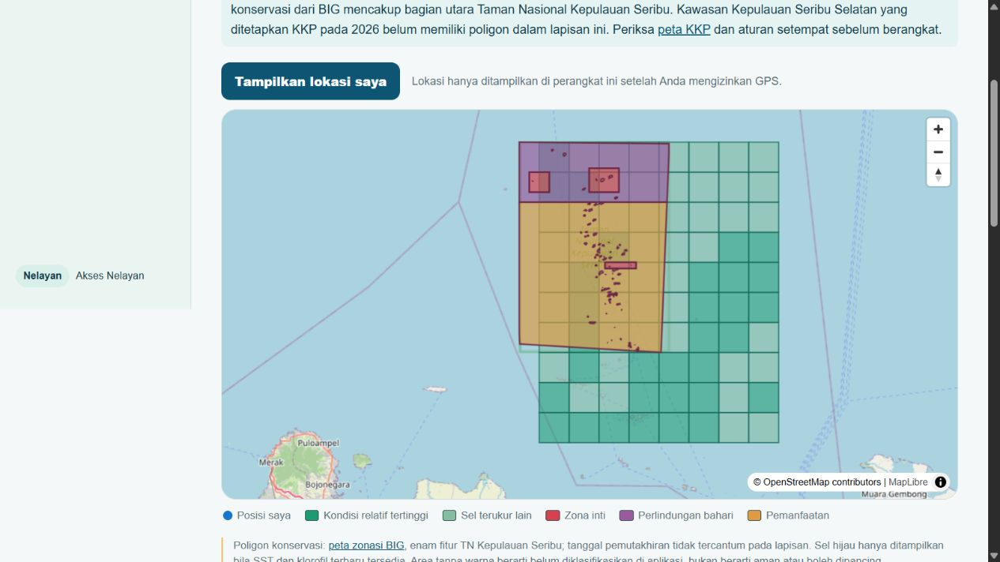

# Progress: Copernicus grid and conservation zoning for Kepulauan Seribu

**Date:** 15 October 2026 (Asia/Jakarta)

## Scope

Keep the pilot in Kepulauan Seribu and show a continuous, data-based division of measured sea conditions alongside the conservation-zone reference layer. The existing Marine adapter uses SST and chlorophyll-a; CDSE Sentinel-2 screens optical changes in two small reef study areas.

## Changes

- Publish every finite 0.05° Marine index cell in the bounded pilot grid, with a 300-cell safety limit, instead of selecting only five separated cells. The index formula is unchanged.
- The first full-grid run (`environment-index-v0.2`) published 164 cells, but visual review showed that the broad original pilot envelope colored some coastal mainland. The corrected envelope is `[106.40, -5.95, 106.90, -5.35]`, centered on the Kepulauan Seribu pilot; its Marine AOI and publication versions are `pilot-aoi-v0.2` and `environment-index-v0.3`. This envelope is an operational study boundary, not an official administrative or legal boundary. The Marine AOI version is scoped separately so the unchanged NOAA and CDSE study-area keys stay stable.
- Serve only the newest acquisition pair and algorithm version to the app. Older cells remain in the database for provenance but cannot mix visually with the current grid. Scores older than seven days are hidden.
- Show the grid as clickable map polygons. Dark green identifies the highest 40% of measured cells by relative SST/chlorophyll index; pale green identifies other measured cells. The six BIG conservation polygons remain above the grid, with their source zone types shown separately.
- Keep the government dashboard's measured-cell count in sync with the same current grid.

## Interpretation and limits

- Green is a relative **sea-condition indicator**, not validated fishing suitability, a catch forecast, a safe-navigation route, or permission to fish. The highest 40% threshold is a display convention within the current pilot grid.
- The BIG polygons are a northern national-park zoning reference. The South Kepulauan Seribu area designated by KKP Decision 28/2026 is not covered by those six polygons. Blank water is unclassified in this app; the official KKP map and current activity rules must be checked independently.
- CDSE Sentinel-2 currently covers only the Pari and Pramuka candidate study squares. Its optical-change output has cloud and quality screening but no validated habitat or fishing-suitability model. It cannot responsibly create conservation boundaries or determine the green fishing layer from those two squares.
- The Marine grid covers the configured pilot envelope and nearby water. The narrowed envelope excludes the mainland cells seen in the first run, but it is not a coastline mask. A 0.05° cell can overlap an island or a smaller legal zone; map colors do not resolve sub-cell boundaries.

## Verification

- TypeScript typecheck and both Node tests passed; ESLint passed with four pre-existing warnings.
- The three focused Python environment-index tests passed. Production Next.js build passed with the same four warnings.
- [GitHub Marine run #3](https://github.com/DavidLauda/Nakhoda/actions/runs/38745940366) succeeded with 164 published cells in version 0.2. The `discovery-metadata` artifact contains 164 unique result keys, SST acquisition `2026-10-14T00:00:00Z`, chlorophyll acquisition `2026-10-13T00:00:00Z`, score range 1–85, and `zoning_unverified` plus `chlorophyll_gapfilled_l4` on every cell. The government dashboard reported 164 current cells after its local preview was restarted.
- [GitHub Marine run #4](https://github.com/DavidLauda/Nakhoda/actions/runs/38747135203) succeeded and published 80 cells from the corrected envelope. Its artifact contains 80 unique result keys in `environment-index-v0.3`, score range 2–88, centers from 106.475°E to 106.825°E and 5.875°S to 5.425°S, and the same two acquisition times. All 80 cells retain `zoning_unverified` and `chlorophyll_gapfilled_l4` flags.
- After restarting the local preview, the government dashboard reported **80 current sea cells**, matching the artifact. The fisher map showed a contiguous green grid around the northern conservation reference polygons without coloring the Jakarta mainland. Clicking a green polygon selected the matching cell details. No GPS location was requested or captured.

## Sources

- [Copernicus Marine SST product](https://data.marine.copernicus.eu/product/SST_GLO_SST_L4_NRT_OBSERVATIONS_010_001/services)
- [Copernicus Marine ocean-colour product](https://data.marine.copernicus.eu/product/OCEANCOLOUR_GLO_BGC_L4_NRT_009_102/services)
- [CDSE Sentinel-2 L2A processing documentation](https://documentation.dataspace.copernicus.eu/APIs/SentinelHub/Process/Examples/S2L2A.html)
- [BIG conservation-zoning service](https://kspservices.big.go.id/satupeta/rest/services/PUBLIK/SUMBER_DAYA_ALAM_DAN_LINGKUNGAN/MapServer/33)
- [KKP Decision 28/2026](https://jdih.kkp.go.id/Homedev/DetailPeraturan/7029)
