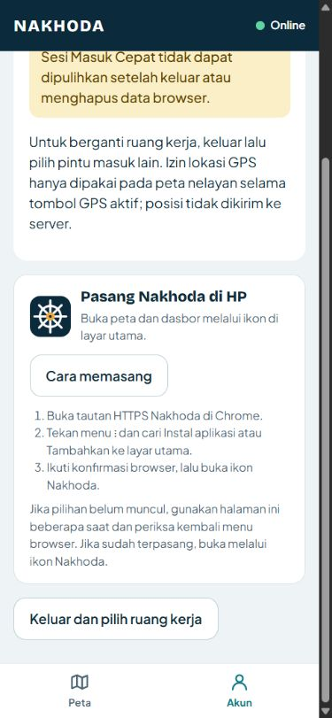

# Progress: Perbaikan Pemasangan PWA dan Ikon Nakhoda

**Tanggal:** 16 Oktober 2026 — Asia/Jakarta  
**Status:** Perbaikan lokal dan build produksi selesai. Instalasi pada HP melalui deployment terbaru masih perlu diuji setelah perubahan di-push dan di-deploy.

## Masalah yang diperiksa

Pengguna tidak menemukan pilihan instalasi pada Chrome Android. Pemeriksaan HTTP tanpa login terhadap [manifest Production](https://nakhoda-eight.vercel.app/manifest.webmanifest) menunjukkan satu ikon SVG dengan `purpose: maskable`, tanpa ikon PNG standar berukuran 192×192 dan 512×512 untuk `purpose: any`. Endpoint [service worker Production](https://nakhoda-eight.vercel.app/sw.js) masih memakai cache `nakhoda-shell-v2`.

Halaman, manifest, SVG, dan service worker tersebut merespons 200; pemeriksaan ini tidak menemukan pengalihan ke login Vercel. Temuan ini mencatat kondisi deployment pada saat pemeriksaan, bukan status setelah deployment berikutnya.

## Perubahan

- Dua logo PNG asli yang diberikan pengguna disimpan di `public/brand/`. Bentuk logo dipertahankan saat menghasilkan ukuran ikon.
- Manifest menggunakan ikon PNG 192×192 dan 512×512 untuk `any`, serta ikon maskable 512×512 terpisah dengan padding. Ikon aplikasi memakai logo terang pada latar navy.
- Apple touch icon 180×180 dan favicon 32×32 ditautkan melalui metadata Next.js.
- Manifest menetapkan identitas aplikasi, scope root, start URL root, bahasa Indonesia, dan mode `standalone`.
- Kartu **Pasang Nakhoda di HP** tersedia pada halaman Quick Login dan Pengaturan. Tombol **Pasang aplikasi** memakai `beforeinstallprompt` ketika browser menyediakannya; jika belum tersedia, **Cara memasang** menampilkan langkah manual Android atau iPhone.
- Event pemasangan ditangkap pada provider layout agar tetap tersedia saat navigasi client. Prompt dikonsumsi sekali dan status terpasang mengikuti event browser atau mode standalone.
- Service worker didaftarkan sekali dari provider. Header manifest dan service worker mencegah penggunaan versi lama tanpa pemeriksaan pembaruan.
- Cache `nakhoda-static-v3` menyimpan ikon dan halaman penjelasan offline. Cache lama milik Nakhoda dibersihkan. API, permintaan berotorisasi, dan tile pihak ketiga tidak dicegat; HTML sesi tidak disimpan dalam cache ini.
- [Panduan deployment](../deployment/2026-10-16-panduan-deploy-vercel.md) diperbarui agar menampilkan konfigurasi baru dan langkah redeploy.

## Verifikasi

- `npm run build`: berhasil, termasuk pemeriksaan TypeScript. Build melaporkan empat warning lama pada elemen gambar dan dependency hook di komponen yang sudah ada.
- `npm test`: 15 tes berhasil, termasuk lima pemeriksaan PWA untuk ikon manifest, safe zone maskable, instalasi cache, pengecualian API/otorisasi, dan fallback navigasi offline.
- Lint pada file yang diubah selesai tanpa error; dua warning gambar lama terdapat pada `PesisirApp.tsx`.
- Build produksi lokal melayani manifest sebagai `application/manifest+json`, ikon sebagai PNG dengan dimensi yang benar, dan service worker sebagai JavaScript; seluruh endpoint yang diperiksa merespons 200. Manifest dan service worker mengirim header pembaruan `no-cache, no-store, must-revalidate`.
- Browser menampilkan logo baru, kartu pemasangan, dan langkah manual setelah tombol diklik. Tata letak diperiksa pada viewport HP 390×844. Tautan manifest, favicon, dan Apple touch icon ada pada HTML.

## Langkah berikutnya dan batas verifikasi

1. Commit dan push perubahan yang sudah ditinjau, lalu pastikan Vercel membangun commit tersebut pada Production. Agen belum melakukan commit, push, atau deployment.
2. Buka kembali `https://nakhoda-eight.vercel.app/` di Chrome Android melalui tab biasa. Periksa **Akun → Pasang Nakhoda di HP** dan menu browser setelah pembaruan.
3. Konfirmasi pemasangan di perangkat, kemudian buka ikon Nakhoda dan uji peta serta GPS.

Prompt browser asli dan pemasangan WebAPK pada HP belum diuji oleh agen. Browser mengatur waktu penawaran pemasangan dan dapat menundanya; status build lokal tidak menjamin prompt muncul seketika pada semua perangkat. Data live dan tile peta tetap membutuhkan internet.

Rujukan: [Kriteria pemasangan Chrome](https://web.dev/articles/install-criteria), [beforeinstallprompt](https://developer.mozilla.org/en-US/docs/Web/API/Window/beforeinstallprompt_event), dan [safe zone ikon maskable](https://web.dev/articles/maskable-icon).
